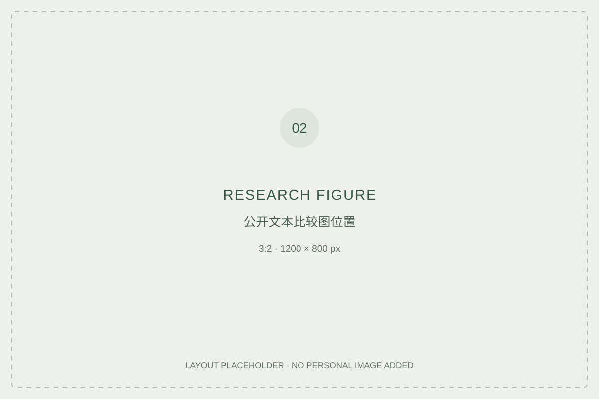

# Pharmaceutical value

**Scientific innovation, commercial returns & social responsibility**

> Status: research framework. No findings or completed manuscript are presented here yet.

## Research question

How do pharmaceutical companies connect patient benefit, scientific innovation and shareholder returns in their public reporting?

## Project introduction

**TEXT 03 — 120–180 words.** Explain the specific question, why these materials were selected, the comparative approach and the limits of public corporate reporting.

## Proposed sources

- [AstraZeneca Annual Report 2025](https://www.astrazeneca.com/investor-relations/annual-reports/annual-report-2025.html)
- [GSK corporate reports](https://www.gsk.com/en-gb/investors/financial-reports/)

These are proposed primary materials, not evidence that analysis has already been completed. The project examines public representations; accounts of patient experience or internal decisions would require different evidence.

## Materials & analysis

| Component | Content to add | Presentation |
|---|---|---|
| Source index | Document, publisher, date, link, page or section, reason for inclusion | A concise table |
| Analysis record | Passage locator, paraphrase, interpretation, alternative reading | A source-to-claim table |
| Figure | A visual comparison grounded in the analysis | Replace IMAGE 02 |
| Reading notes | 6–8 verified works, including published ethnographic research | Notes with links and reading-depth labels |

## Article

**TEXT 04 — Full analysis, approximately 3,000–3,500 words once authored.**

Suggested sections: question and argument; materials and method; analysis of innovation; patient and commercial value; tensions and alternative interpretations; conclusion; references.

The article entry will be linked here once an actual manuscript exists.

## Image guidance

Use a source comparison or analytical figure with a caption explaining the documents and what the figure represents. An unrelated laboratory stock photograph would add no evidence to this project.

---

[Back to profile](https://github.com/xuliangweiming)
